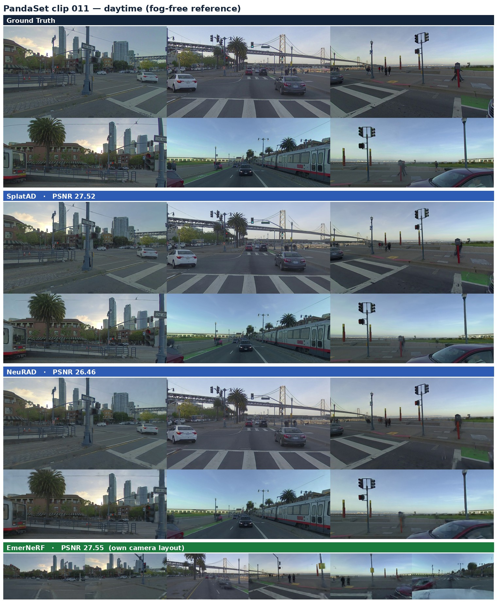
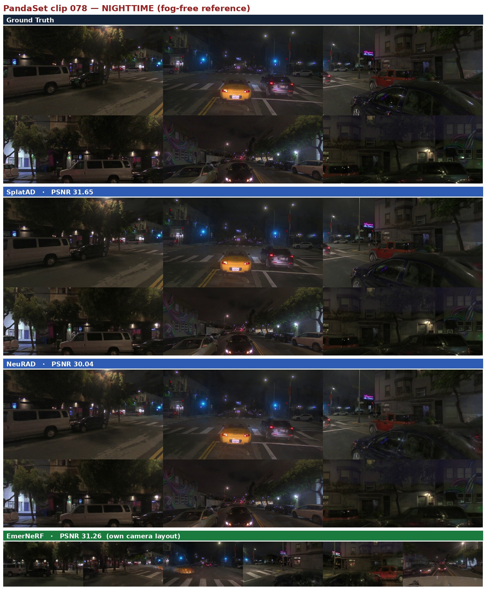

# FoggyFields — AV Neural-Field Baselines (SplatAD · NeuRAD · EmerNeRF)

Reproduction of three autonomous-driving neural-field methods on a custom **foggy**
multi-camera + LiDAR benchmark, plus PandaSet reference runs. Part of the
**FoggyFields** project (physically-consistent RGB + LiDAR foggy neural field).

| Method | Type | Repo (upstream) | Pinned commit |
|---|---|---|---|
| **SplatAD** (CVPR'25) | 3D Gaussian Splatting for AD | `carlinds/splatad` (gsplat) + `georghess/neurad-studio` | `6e31ad7` / `e6f7e4e` |
| **NeuRAD** (CVPR'24) | NeRF for AD | `georghess/neurad-studio` | `e6f7e4e` |
| **EmerNeRF** (NeurIPS'23) | self-supervised dynamic NeRF | `NVlabs/EmerNeRF` | `8c051d7` |

Datasets:
- **NFF** (foggy, 15 clips) and **NCF** (clear, 17 clips) — 7 rectified cameras + one
  **128**-beam LiDAR + radar, derived from NVIDIA PhysicalAI-AV / NCore. On-disk layout
  is `clips/<ID>__<hash>/`. Both HuggingFace repos are **private**: `JocelynW/NFF`,
  `JocelynW/NCF`. (The clips called `002`/`003`/`004` in the old results are the same
  scenes under the legacy `processed/` layout.)
- **PandaSet** — reference clips `011`, `078` (6 cameras + LiDAR).

> **This repo is code-only.** Checkpoints (~18 GB) and the processed dataset (~4.4 GB)
> live on HuggingFace — see [`CHECKPOINTS.md`](CHECKPOINTS.md). Renders/videos are
> **not** stored anywhere: they regenerate from a checkpoint in minutes (see REPRODUCE).

---

## Why this repo exists / how to use it on a new machine

We do **not** vendor the three upstream forks (they are ~100 MB + 4 GB). Instead we ship
our changes as **git patches against pinned upstream commits** (`patches/`), with
**plain-file copies** of every new/modified file as a fallback (`src/`). A fresh machine
(or a fresh agent) reproduces the full environment by:

1. cloning the three upstreams at the pinned commits (`BASE_COMMITS.txt`),
2. applying our patches,
3. building the env (conda or Apptainer) and **rebuilding the CUDA extensions for the
   target GPU arch** (gsplat + tiny-cuda-nn are arch-specific — this is the one real
   reproducibility gotcha; see [`REPRODUCE.md`](REPRODUCE.md) §4),
4. downloading data + checkpoints from HuggingFace,
5. training or just rendering/evaluating.

**Start here → [`REPRODUCE.md`](REPRODUCE.md)** (step-by-step, copy-pasteable).

---

## Repo layout

```
foggyfields-av-baselines/
├── README.md                ← you are here
├── REPRODUCE.md             ← master step-by-step reproduce guide (READ THIS)
├── RESULTS.md               ← results report: PSNR/SSIM/LPIPS/LiDAR, time, iterations, best ckpt
├── DATASET_NOTES.md         ← ⚠️ clip lighting/weather: which clips are NIGHT (PandaSet 078!)
├── CHECKPOINTS.md           ← HuggingFace model/dataset manifest (what to download)
├── BASE_COMMITS.txt         ← exact upstream commits to clone
├── patches/
│   ├── neurad-studio.patch  ← our SplatAD+NeuRAD changes (dataparser + 7 files)
│   └── emernerf.patch       ← our EmerNeRF changes (loader + configs, incl. split fix)
├── src/                     ← plain-file fallback of every new/modified file
│   ├── neurad-studio/.../nvidia_av_fog_dataparser.py
│   └── emernerf/{datasets/*, configs/*}
├── jobs/                    ← SLURM sbatch + render/metric/viz Python (38 scripts)
│   ├── nvidia_fog_{splatad,neurad,emernerf}.sbatch   ← train + render + metrics drivers
│   ├── pngs_to_mp4_nvidia_fog.py   ← ★ the 7-camera panorama video renderer
│   ├── compute_{rgb,lidar}_metrics.py, compute_lpips_emernerf.py
│   └── ... (bbox overlay, lidar BEV, env-build scripts)
├── env/                     ← conda yaml + pip freeze + SETUP.md (Blackwell build notes)
├── results/metrics/nvidia/  ← authoritative per-clip metric JSONs (committed)
├── jobs/regimes.sh          ← ★ v2fixed vs legacy_prefix flag sets + output dirs
└── scripts/
    ├── regen_patches.sh     ← regenerate patches/ + src/ from two upstream worktrees
    ├── setup_new_machine.sh ← clone upstreams + apply patches (one command)
    ├── stage_checkpoints.sh ← gather best checkpoints into an HF upload tree
    └── upload_hf.sh         ← push checkpoints to HuggingFace (after `hf auth login`)
```

---

## ⚠️ The published numbers below are SUPERSEDED

Six verified dataparser defects (F1–F6) were fixed on branch
`fix/camera-timing-lidar-frame-v2`. Everything in `RESULTS.md` and
`results/metrics/**` was produced before that. They are **kept, not deleted**, and
labelled; do not quote them.

| | defect | measured magnitude |
|---|---|---|
| **F1** | every camera got the LiDAR spin-centre timestamp instead of its own | up to **16.06 ms** per camera and **29.77 ms** between the two trigger groups (clip-specific); worst measured ego displacement **65 cm** (NFF-14, 19.43 ms at 120 km/h); also mistimed actor interpolation |
| **F2** | `rolling_shutter_time = 0` although `shutter_delay_us = 30559` is published | a 30.559 ms readout treated as global shutter |
| **F3** | sensor-frame LiDAR transformed as if ego-frame | **1.94 m** vertical offset; world-frame ground at −1.94 m |
| **F4** | class whitelist did not match the NCore vocabulary | `rider`, `animal`, `train_or_tram_car`, `stroller`, `protruding_object` silently dropped; NCF-08 alone loses 19,396 `person` boxes |
| **F5** | `stationary` hardcoded `False` | 4/704 fog and 30/3316 clear tracks are in fact stationary |
| **F6** | `LidarType.PANDAR64` for a 128-beam LiDAR | ray-drop rasterised onto 64 wrong elevations |

Plus an adaptation to **rectification v2** (per-camera K at native angular resolution —
the front tele goes from 11.2 to 65.2 px/deg — with `safe_crop`, valid masks and a
per-pixel rolling-shutter lookup).

All of it is written up in [`DATASET_NOTES.md`](DATASET_NOTES.md). The corrected
behaviour is the default; the old behaviour is reproducible on purpose via
`jobs/regimes.sh` (`set_regime legacy_prefix`), which writes to a
`legacy_prefix_SUPERSEDED/` output directory.

---

## Headline results (held-out novel-view, nvs_50_50) — SUPERSEDED, see above

NVIDIA_AV_Fog, mean over clips 002/003/004 — full table in [`RESULTS.md`](RESULTS.md):

| Method | PSNR↑ | SSIM↑ | LPIPS↓ | LiDAR depth median↓ | Best at |
|---|---|---|---|---|---|
| EmerNeRF† | ~33 | ~0.95 | ~0.16 | — | RGB (all clips) |
| NeuRAD | 28.9 | 0.897 | 0.164 | **7.4 m** | LiDAR depth |
| SplatAD | 23.4 | 0.868 | 0.363 | 10.7 m | speed |

† EmerNeRF NVIDIA numbers are **pending re-train** — see the split-fix note below.

## Qualitative — PandaSet multi-camera comparison (fog-free reference)

Held-out novel-view renders, all cameras at once (GT vs each method). Day vs night:

**Clip 011 — daytime**


**Clip 078 — nighttime** (see `DATASET_NOTES.md`)


SplatAD / NeuRAD share the nerfstudio 6-camera panorama layout; EmerNeRF uses its own
camera arrangement (labelled). Full per-clip videos: `Code/outputs/.../videos/val/panorama_rgb.mp4`.

---

## ⚠️ Important: EmerNeRF eval-split fix (must re-train EmerNeRF)

A bug was found and fixed: EmerNeRF previously held out the **complementary** 50/50
frame set (even frames) vs SplatAD/NeuRAD (odd frames), so the old EmerNeRF numbers were
measured on the *opposite* views and are not strictly comparable. The loader now reads the
official `splits/nvs_50_50.json` directly (`src/emernerf/datasets/nvidia_av_fog.py` →
`split_train_test`), so **all three methods hold out the identical odd frames**.

→ The EmerNeRF NVIDIA checkpoints on HuggingFace are the **pre-fix** ones (flagged stale);
**re-train EmerNeRF on the new machine** with the fixed loader to refresh those numbers.
SplatAD/NeuRAD are unaffected and final.

---

## Conventions / what was hard (so you don't rediscover it)

- **Poses:** `T_camera_rig.json` / `T_lidar_rig.json` are **rig←sensor**, used *directly*
  (no inverse). World frame is **already ISO 8855** — no extra rotation. (Inverting either,
  or adding the "ISO rotation", silently drops PSNR to ~20 and renders garbage — verified.
  That matrix was also a det=−1 reflection; it has been deleted from both codebases.)
- **LiDAR sweeps** `[N,6]=(x,y,z,intensity,t_offset_us,ring_id)`. The xyz **frame is per
  clip** — read `provenance.lidar_frame`; sensor-frame clips need `T_lidar_rig` applied
  first, and getting it wrong is a 1.94 m vertical error (F3). Column 4 is a **relative**
  offset (−50006…+50008 µs), whatever the dataset's CONVENTIONS.md says.
- **Camera timestamps** are per camera, in two trigger groups whose separation is
  **clip-specific** (0.01 ms on NCF-03 … 29.77 ms on NCF-01, sign varies). Read each
  clip's own file; never reuse the LiDAR timestamp and never assume a constant (F1).
- **CUDA arch:** gsplat + tiny-cuda-nn JIT/compile against `TORCH_CUDA_ARCH_LIST`
  (hard-coded Blackwell `12.0` in the sbatch files). **Set it from `nvidia-smi
  --query-gpu=compute_cap` on the new GPU and force-rebuild** — see REPRODUCE §4.
- Always `export PYTHONNOUSERSITE=1` (user-site numpy shadows the env otherwise).

See [`RESULTS.md`](RESULTS.md) for the full reproduction notes and per-clip numbers.
