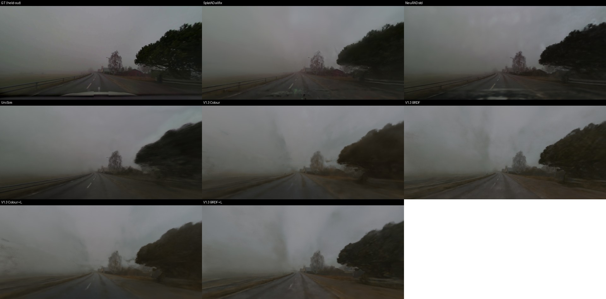
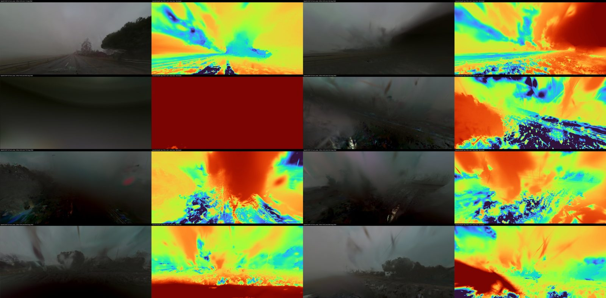

# FINAL TABLE — SOTA baselines vs FoggyField V1.3 on NFF-02 / NFF-08 / NFF-10 (one common evaluator)

_Auto-generated by `jobs/final/final_table.py` at 2026-11-25 18:14 from the metric JSONs; `n/a` = run not finished yet._ **IN PROGRESS** — 12 work unit(s) still running/queued; see `STATUS.md`.

Protocol: split `nvs_50_50` (train even timesteps, eval the 99 odd ones). RGB = safe_crop pixels, 7 cameras x 99 frames = 693 images (PSNR/SSIM/LPIPS-alex). LiDAR = 99 held-out sweeps, GT-returned rays only, one predicted point per ray (rendered range along the GT ray): CD = symmetric mean NN distance, CD² = squared variant / |G|, depth median = median |r_pred−r_gt|. No method's ray-drop head is used (oracle drop) so every row is scored on the same rays. Details + per-run wall time: `baselines/RESULTS_BASELINES.md`.

**Fair budget:** every row of the main tables trained exactly 30 000 steps (each method's LR schedule stretched to 30k where its default was shorter: UniSim 20k -> 30k incl. its stage schedule, EmerNeRF 25k -> 30k, V1.3 5k -> 30k with its 4 stages x6). Same split (nvs_50_50), same 693 held-out images and 99 held-out LiDAR sweeps, same evaluator for every row. Bold = best in the column.

**Validation marks** (`baselines/CONVERGENCE.md`: finished, finite loss, loss plateau, train/held-out gap, renders not grey): plain number = PASS; `⚠` = a check FAILED (do not cite without reading CONVERGENCE.md); `†` = not fully validated yet.

## Fair comparison — every method trained 30000 steps, same held-out set

### PSNR ↑

| method | group | steps | NFF-02 | NFF-08 | NFF-10 | NFF-05 (night) | mean (3 fog clips) |
|---|---|---|---|---|---|---|---|
| SplatAD (allfix: opacity reg 5e-4 + F1b/F2b) | SOTA | 30k | **34.70** | **34.47** | 32.61 | n/a | **33.93** |
| SplatAD (opreg5e4, pre-fix data path) | SOTA | 30k | 34.31 | 33.11 ⚠ | **33.01** | n/a | 33.48 |
| NeuRAD (standard, corrected bench) | SOTA | 30k | 33.87 | n/a | n/a | n/a | n/a |
| UniSim (corrected bench, no ray drop; schedule x1.5) | SOTA | 30k | n/a | n/a | n/a | n/a | n/a |
| EmerNeRF (corrected bench) | SOTA | 30k | n/a | n/a | n/a | n/a | n/a |

### SSIM ↑

| method | group | steps | NFF-02 | NFF-08 | NFF-10 | NFF-05 (night) | mean (3 fog clips) |
|---|---|---|---|---|---|---|---|
| SplatAD (allfix: opacity reg 5e-4 + F1b/F2b) | SOTA | 30k | **0.971** | **0.971** | 0.963 | n/a | **0.969** |
| SplatAD (opreg5e4, pre-fix data path) | SOTA | 30k | 0.971 | 0.969 ⚠ | **0.963** | n/a | 0.968 |
| NeuRAD (standard, corrected bench) | SOTA | 30k | 0.957 | n/a | n/a | n/a | n/a |
| UniSim (corrected bench, no ray drop; schedule x1.5) | SOTA | 30k | n/a | n/a | n/a | n/a | n/a |
| EmerNeRF (corrected bench) | SOTA | 30k | n/a | n/a | n/a | n/a | n/a |

### LPIPS ↓

| method | group | steps | NFF-02 | NFF-08 | NFF-10 | NFF-05 (night) | mean (3 fog clips) |
|---|---|---|---|---|---|---|---|
| SplatAD (allfix: opacity reg 5e-4 + F1b/F2b) | SOTA | 30k | **0.126** | **0.132** | 0.164 | n/a | **0.141** |
| SplatAD (opreg5e4, pre-fix data path) | SOTA | 30k | 0.127 | 0.146 ⚠ | **0.164** | n/a | 0.146 |
| NeuRAD (standard, corrected bench) | SOTA | 30k | 0.138 | n/a | n/a | n/a | n/a |
| UniSim (corrected bench, no ray drop; schedule x1.5) | SOTA | 30k | n/a | n/a | n/a | n/a | n/a |
| EmerNeRF (corrected bench) | SOTA | 30k | n/a | n/a | n/a | n/a | n/a |

### LiDAR CD (m) ↓

| method | group | steps | NFF-02 | NFF-08 | NFF-10 | NFF-05 (night) | mean (3 fog clips) |
|---|---|---|---|---|---|---|---|
| SplatAD (allfix: opacity reg 5e-4 + F1b/F2b) | SOTA | 30k | 0.532 | **0.559** | 0.630 | n/a | 0.573 |
| SplatAD (opreg5e4, pre-fix data path) | SOTA | 30k | **0.521** | 0.571 ⚠ | **0.615** | n/a | **0.569** |
| NeuRAD (standard, corrected bench) | SOTA | 30k | 0.706 | n/a | n/a | n/a | n/a |
| UniSim (corrected bench, no ray drop; schedule x1.5) | SOTA | 30k | n/a | n/a | n/a | n/a | n/a |
| EmerNeRF (corrected bench) | SOTA | 30k | n/a | n/a | n/a | n/a | n/a |

### CD² (m²) ↓

| method | group | steps | NFF-02 | NFF-08 | NFF-10 | NFF-05 (night) | mean (3 fog clips) |
|---|---|---|---|---|---|---|---|
| SplatAD (allfix: opacity reg 5e-4 + F1b/F2b) | SOTA | 30k | 5.74 | **12.94** | 12.48 | n/a | 10.39 |
| SplatAD (opreg5e4, pre-fix data path) | SOTA | 30k | **5.14** | 12.95 ⚠ | **12.38** | n/a | **10.16** |
| NeuRAD (standard, corrected bench) | SOTA | 30k | 71.66 | n/a | n/a | n/a | n/a |
| UniSim (corrected bench, no ray drop; schedule x1.5) | SOTA | 30k | n/a | n/a | n/a | n/a | n/a |
| EmerNeRF (corrected bench) | SOTA | 30k | n/a | n/a | n/a | n/a | n/a |

### depth median |Δr| (m) ↓

| method | group | steps | NFF-02 | NFF-08 | NFF-10 | NFF-05 (night) | mean (3 fog clips) |
|---|---|---|---|---|---|---|---|
| SplatAD (allfix: opacity reg 5e-4 + F1b/F2b) | SOTA | 30k | 1.044 | **1.074** | 1.342 | n/a | 1.153 |
| SplatAD (opreg5e4, pre-fix data path) | SOTA | 30k | 0.997 | 1.146 ⚠ | **1.314** | n/a | **1.152** |
| NeuRAD (standard, corrected bench) | SOTA | 30k | **0.101** | n/a | n/a | n/a | n/a |
| UniSim (corrected bench, no ray drop; schedule x1.5) | SOTA | 30k | n/a | n/a | n/a | n/a | n/a |
| EmerNeRF (corrected bench) | SOTA | 30k | n/a | n/a | n/a | n/a | n/a |

### LiDAR accuracy pred→GT (m) ↓

| method | group | steps | NFF-02 | NFF-08 | NFF-10 | NFF-05 (night) | mean (3 fog clips) |
|---|---|---|---|---|---|---|---|
| SplatAD (allfix: opacity reg 5e-4 + F1b/F2b) | SOTA | 30k | n/a | n/a | n/a | n/a | n/a |
| SplatAD (opreg5e4, pre-fix data path) | SOTA | 30k | n/a | n/a | n/a | n/a | n/a |
| NeuRAD (standard, corrected bench) | SOTA | 30k | n/a | n/a | n/a | n/a | n/a |
| UniSim (corrected bench, no ray drop; schedule x1.5) | SOTA | 30k | n/a | n/a | n/a | n/a | n/a |
| EmerNeRF (corrected bench) | SOTA | 30k | n/a | n/a | n/a | n/a | n/a |

### LiDAR completeness GT→pred (m) ↓

| method | group | steps | NFF-02 | NFF-08 | NFF-10 | NFF-05 (night) | mean (3 fog clips) |
|---|---|---|---|---|---|---|---|
| SplatAD (allfix: opacity reg 5e-4 + F1b/F2b) | SOTA | 30k | n/a | n/a | n/a | n/a | n/a |
| SplatAD (opreg5e4, pre-fix data path) | SOTA | 30k | n/a | n/a | n/a | n/a | n/a |
| NeuRAD (standard, corrected bench) | SOTA | 30k | n/a | n/a | n/a | n/a | n/a |
| UniSim (corrected bench, no ray drop; schedule x1.5) | SOTA | 30k | n/a | n/a | n/a | n/a | n/a |
| EmerNeRF (corrected bench) | SOTA | 30k | n/a | n/a | n/a | n/a | n/a |

### LiDAR F-score @0.2 m ↑

| method | group | steps | NFF-02 | NFF-08 | NFF-10 | NFF-05 (night) | mean (3 fog clips) |
|---|---|---|---|---|---|---|---|
| SplatAD (allfix: opacity reg 5e-4 + F1b/F2b) | SOTA | 30k | n/a | n/a | n/a | n/a | n/a |
| SplatAD (opreg5e4, pre-fix data path) | SOTA | 30k | n/a | n/a | n/a | n/a | n/a |
| NeuRAD (standard, corrected bench) | SOTA | 30k | n/a | n/a | n/a | n/a | n/a |
| UniSim (corrected bench, no ray drop; schedule x1.5) | SOTA | 30k | n/a | n/a | n/a | n/a | n/a |
| EmerNeRF (corrected bench) | SOTA | 30k | n/a | n/a | n/a | n/a | n/a |

### LiDAR occupancy IoU @0.2 m voxels ↑

| method | group | steps | NFF-02 | NFF-08 | NFF-10 | NFF-05 (night) | mean (3 fog clips) |
|---|---|---|---|---|---|---|---|
| SplatAD (allfix: opacity reg 5e-4 + F1b/F2b) | SOTA | 30k | n/a | n/a | n/a | n/a | n/a |
| SplatAD (opreg5e4, pre-fix data path) | SOTA | 30k | n/a | n/a | n/a | n/a | n/a |
| NeuRAD (standard, corrected bench) | SOTA | 30k | n/a | n/a | n/a | n/a | n/a |
| UniSim (corrected bench, no ray drop; schedule x1.5) | SOTA | 30k | n/a | n/a | n/a | n/a | n/a |
| EmerNeRF (corrected bench) | SOTA | 30k | n/a | n/a | n/a | n/a | n/a |

### LiDAR occupancy IoU @0.5 m voxels ↑

| method | group | steps | NFF-02 | NFF-08 | NFF-10 | NFF-05 (night) | mean (3 fog clips) |
|---|---|---|---|---|---|---|---|
| SplatAD (allfix: opacity reg 5e-4 + F1b/F2b) | SOTA | 30k | n/a | n/a | n/a | n/a | n/a |
| SplatAD (opreg5e4, pre-fix data path) | SOTA | 30k | n/a | n/a | n/a | n/a | n/a |
| NeuRAD (standard, corrected bench) | SOTA | 30k | n/a | n/a | n/a | n/a | n/a |
| UniSim (corrected bench, no ray drop; schedule x1.5) | SOTA | 30k | n/a | n/a | n/a | n/a | n/a |
| EmerNeRF (corrected bench) | SOTA | 30k | n/a | n/a | n/a | n/a | n/a |

### LiDAR range MAE (m) ↓

| method | group | steps | NFF-02 | NFF-08 | NFF-10 | NFF-05 (night) | mean (3 fog clips) |
|---|---|---|---|---|---|---|---|
| SplatAD (allfix: opacity reg 5e-4 + F1b/F2b) | SOTA | 30k | n/a | n/a | n/a | n/a | n/a |
| SplatAD (opreg5e4, pre-fix data path) | SOTA | 30k | n/a | n/a | n/a | n/a | n/a |
| NeuRAD (standard, corrected bench) | SOTA | 30k | n/a | n/a | n/a | n/a | n/a |
| UniSim (corrected bench, no ray drop; schedule x1.5) | SOTA | 30k | n/a | n/a | n/a | n/a | n/a |
| EmerNeRF (corrected bench) | SOTA | 30k | n/a | n/a | n/a | n/a | n/a |

### LiDAR intensity RMSE (all returns, /255) ↓

| method | group | steps | NFF-02 | NFF-08 | NFF-10 | NFF-05 (night) | mean (3 fog clips) |
|---|---|---|---|---|---|---|---|
| SplatAD (allfix: opacity reg 5e-4 + F1b/F2b) | SOTA | 30k | n/a | n/a | n/a | n/a | n/a |
| SplatAD (opreg5e4, pre-fix data path) | SOTA | 30k | n/a | n/a | n/a | n/a | n/a |
| NeuRAD (standard, corrected bench) | SOTA | 30k | n/a | n/a | n/a | n/a | n/a |
| UniSim (corrected bench, no ray drop; schedule x1.5) | SOTA | 30k | n/a | n/a | n/a | n/a | n/a |
| EmerNeRF (corrected bench) | SOTA | 30k | n/a | n/a | n/a | n/a | n/a |

### LiDAR intensity RMSE (unsaturated returns, /255) ↓

| method | group | steps | NFF-02 | NFF-08 | NFF-10 | NFF-05 (night) | mean (3 fog clips) |
|---|---|---|---|---|---|---|---|
| SplatAD (allfix: opacity reg 5e-4 + F1b/F2b) | SOTA | 30k | n/a | n/a | n/a | n/a | n/a |
| SplatAD (opreg5e4, pre-fix data path) | SOTA | 30k | n/a | n/a | n/a | n/a | n/a |
| NeuRAD (standard, corrected bench) | SOTA | 30k | n/a | n/a | n/a | n/a | n/a |
| UniSim (corrected bench, no ray drop; schedule x1.5) | SOTA | 30k | n/a | n/a | n/a | n/a | n/a |
| EmerNeRF (corrected bench) | SOTA | 30k | n/a | n/a | n/a | n/a | n/a |

## Training cost (one GH200 GPU per run; same 30k steps)

Cell = optimisation time h (logged wall-clock h incl. start-up and chunk restarts) · s/step. Steps are NOT equal work: SplatAD = 1 camera image per step; NeuRAD / UniSim = ray batches (camera + LiDAR rays); EmerNeRF = ray batch; V1.3 = NeuRAD ray batch + physics terms.

| method | NFF-02 | NFF-08 | NFF-10 | NFF-05 | total optimisation h (3 clips) |
|---|---|---|---|---|---|
| SplatAD (allfix: opacity reg 5e-4 + F1b/F2b) | 0.71 h (0.85 h) · 0.085 s | 0.67 h (0.81 h) · 0.080 s | 0.89 h (1.10 h) · 0.107 s | n/a | 2.28 h |
| SplatAD (opreg5e4, pre-fix data path) | 0.69 h (0.81 h) · 0.083 s | 0.63 h (0.75 h) · 0.075 s | 0.73 h (0.87 h) · 0.087 s | n/a | 2.04 h |
| NeuRAD (standard, corrected bench) | 1.09 h (1.45 h) · 0.131 s | n/a | n/a | n/a | 1.09 h |
| UniSim (corrected bench, no ray drop; schedule x1.5) | n/a | n/a | n/a | n/a | n/a |
| EmerNeRF (corrected bench) | n/a | n/a | n/a | n/a | n/a |

## Appendix (records) — our earlier FoggyField V1.3 lanes at 5k steps (NOT budget-matched; V1.3 paused 2026-11-25, baselines only)

### PSNR ↑

| method | group | steps | NFF-02 | NFF-08 | NFF-10 | NFF-05 (night) | mean (3 fog clips) |
|---|---|---|---|---|---|---|---|
| NeuRAD A0 (V1.3 suite, 5k) | ours-suite | 5k | **31.16** | **32.62** | **30.35** | n/a | **31.38** |
| FoggyField V1.3 BRDF (U0 / C7gR, 5k) | ours | 5k | 29.38 | 29.66 | 27.71 | n/a | 28.92 |
| FoggyField V1.3 Colour (UcnnR, 5k) | ours | 5k | 29.88 | 30.26 | 28.30 | n/a | 29.48 |
| FoggyField V1.3 BRDF + LiDAR (F, 5k) | ours | 5k | 29.38 | 29.60 | 27.71 | n/a | 28.89 |
| FoggyField V1.3 Colour + LiDAR (Fc, 5k) | ours | 5k | 29.95 | 30.14 | 28.25 | n/a | 29.45 |

### SSIM ↑

| method | group | steps | NFF-02 | NFF-08 | NFF-10 | NFF-05 (night) | mean (3 fog clips) |
|---|---|---|---|---|---|---|---|
| NeuRAD A0 (V1.3 suite, 5k) | ours-suite | 5k | 0.938 | **0.953** | **0.940** | n/a | **0.944** |
| FoggyField V1.3 BRDF (U0 / C7gR, 5k) | ours | 5k | 0.943 | 0.952 | 0.934 | n/a | 0.943 |
| FoggyField V1.3 Colour (UcnnR, 5k) | ours | 5k | **0.945** | 0.953 | 0.933 | n/a | 0.943 |
| FoggyField V1.3 BRDF + LiDAR (F, 5k) | ours | 5k | 0.943 | 0.952 | 0.934 | n/a | 0.943 |
| FoggyField V1.3 Colour + LiDAR (Fc, 5k) | ours | 5k | 0.944 | 0.951 | 0.933 | n/a | 0.943 |

### LPIPS ↓

| method | group | steps | NFF-02 | NFF-08 | NFF-10 | NFF-05 (night) | mean (3 fog clips) |
|---|---|---|---|---|---|---|---|
| NeuRAD A0 (V1.3 suite, 5k) | ours-suite | 5k | **0.215** | **0.194** | **0.236** | n/a | **0.215** |
| FoggyField V1.3 BRDF (U0 / C7gR, 5k) | ours | 5k | 0.228 | 0.195 | 0.271 | n/a | 0.232 |
| FoggyField V1.3 Colour (UcnnR, 5k) | ours | 5k | 0.254 | 0.224 | 0.306 | n/a | 0.261 |
| FoggyField V1.3 BRDF + LiDAR (F, 5k) | ours | 5k | 0.231 | 0.195 | 0.272 | n/a | 0.233 |
| FoggyField V1.3 Colour + LiDAR (Fc, 5k) | ours | 5k | 0.251 | 0.224 | 0.305 | n/a | 0.260 |

### LiDAR CD (m) ↓

| method | group | steps | NFF-02 | NFF-08 | NFF-10 | NFF-05 (night) | mean (3 fog clips) |
|---|---|---|---|---|---|---|---|
| NeuRAD A0 (V1.3 suite, 5k) | ours-suite | 5k | 0.691 | 0.744 | 0.584 | n/a | 0.673 |
| FoggyField V1.3 BRDF (U0 / C7gR, 5k) | ours | 5k | **0.462** | 0.519 | **0.452** | n/a | 0.478 |
| FoggyField V1.3 Colour (UcnnR, 5k) | ours | 5k | 0.469 | **0.503** | 0.454 | n/a | **0.475** |
| FoggyField V1.3 BRDF + LiDAR (F, 5k) | ours | 5k | 0.479 | 0.544 | 0.455 | n/a | 0.493 |
| FoggyField V1.3 Colour + LiDAR (Fc, 5k) | ours | 5k | 0.482 | 0.521 | 0.464 | n/a | 0.489 |

### CD² (m²) ↓

| method | group | steps | NFF-02 | NFF-08 | NFF-10 | NFF-05 (night) | mean (3 fog clips) |
|---|---|---|---|---|---|---|---|
| NeuRAD A0 (V1.3 suite, 5k) | ours-suite | 5k | 68.00 | 59.15 | 36.19 | n/a | 54.45 |
| FoggyField V1.3 BRDF (U0 / C7gR, 5k) | ours | 5k | 30.72 | 27.88 | 12.79 | n/a | 23.79 |
| FoggyField V1.3 Colour (UcnnR, 5k) | ours | 5k | **30.21** | **26.60** | **11.62** | n/a | **22.81** |
| FoggyField V1.3 BRDF + LiDAR (F, 5k) | ours | 5k | 33.66 | 30.13 | 13.90 | n/a | 25.90 |
| FoggyField V1.3 Colour + LiDAR (Fc, 5k) | ours | 5k | 32.56 | 29.67 | 12.42 | n/a | 24.88 |

### depth median |Δr| (m) ↓

| method | group | steps | NFF-02 | NFF-08 | NFF-10 | NFF-05 (night) | mean (3 fog clips) |
|---|---|---|---|---|---|---|---|
| NeuRAD A0 (V1.3 suite, 5k) | ours-suite | 5k | **0.146** | **0.163** | **0.379** | n/a | **0.229** |
| FoggyField V1.3 BRDF (U0 / C7gR, 5k) | ours | 5k | 0.187 | 0.242 | 0.437 | n/a | 0.289 |
| FoggyField V1.3 Colour (UcnnR, 5k) | ours | 5k | 0.180 | 0.242 | 0.448 | n/a | 0.290 |
| FoggyField V1.3 BRDF + LiDAR (F, 5k) | ours | 5k | 0.184 | 0.237 | 0.442 | n/a | 0.287 |
| FoggyField V1.3 Colour + LiDAR (Fc, 5k) | ours | 5k | 0.178 | 0.236 | 0.459 | n/a | 0.291 |

### LiDAR accuracy pred→GT (m) ↓

| method | group | steps | NFF-02 | NFF-08 | NFF-10 | NFF-05 (night) | mean (3 fog clips) |
|---|---|---|---|---|---|---|---|
| NeuRAD A0 (V1.3 suite, 5k) | ours-suite | 5k | 1.167 | 1.249 | 0.825 | n/a | 1.080 |
| FoggyField V1.3 BRDF (U0 / C7gR, 5k) | ours | 5k | **0.633** | 0.731 | 0.372 | n/a | 0.579 |
| FoggyField V1.3 Colour (UcnnR, 5k) | ours | 5k | 0.642 | **0.712** | **0.356** | n/a | **0.570** |
| FoggyField V1.3 BRDF + LiDAR (F, 5k) | ours | 5k | 0.674 | 0.772 | 0.383 | n/a | 0.610 |
| FoggyField V1.3 Colour + LiDAR (Fc, 5k) | ours | 5k | 0.652 | 0.745 | 0.377 | n/a | 0.591 |

### LiDAR completeness GT→pred (m) ↓

| method | group | steps | NFF-02 | NFF-08 | NFF-10 | NFF-05 (night) | mean (3 fog clips) |
|---|---|---|---|---|---|---|---|
| NeuRAD A0 (V1.3 suite, 5k) | ours-suite | 5k | **0.204** | **0.243** | **0.336** | n/a | **0.261** |
| FoggyField V1.3 BRDF (U0 / C7gR, 5k) | ours | 5k | 0.291 | 0.307 | 0.533 | n/a | 0.377 |
| FoggyField V1.3 Colour (UcnnR, 5k) | ours | 5k | 0.296 | 0.294 | 0.551 | n/a | 0.380 |
| FoggyField V1.3 BRDF + LiDAR (F, 5k) | ours | 5k | 0.285 | 0.316 | 0.526 | n/a | 0.376 |
| FoggyField V1.3 Colour + LiDAR (Fc, 5k) | ours | 5k | 0.312 | 0.298 | 0.550 | n/a | 0.387 |

### LiDAR F-score @0.2 m ↑

| method | group | steps | NFF-02 | NFF-08 | NFF-10 | NFF-05 (night) | mean (3 fog clips) |
|---|---|---|---|---|---|---|---|
| NeuRAD A0 (V1.3 suite, 5k) | ours-suite | 5k | **0.778** | **0.761** | **0.674** | n/a | **0.738** |
| FoggyField V1.3 BRDF (U0 / C7gR, 5k) | ours | 5k | 0.751 | 0.707 | 0.621 | n/a | 0.693 |
| FoggyField V1.3 Colour (UcnnR, 5k) | ours | 5k | 0.757 | 0.710 | 0.614 | n/a | 0.694 |
| FoggyField V1.3 BRDF + LiDAR (F, 5k) | ours | 5k | 0.754 | 0.709 | 0.621 | n/a | 0.695 |
| FoggyField V1.3 Colour + LiDAR (Fc, 5k) | ours | 5k | 0.756 | 0.718 | 0.613 | n/a | 0.696 |

### LiDAR occupancy IoU @0.2 m voxels ↑

| method | group | steps | NFF-02 | NFF-08 | NFF-10 | NFF-05 (night) | mean (3 fog clips) |
|---|---|---|---|---|---|---|---|
| NeuRAD A0 (V1.3 suite, 5k) | ours-suite | 5k | **0.246** | **0.254** | **0.186** | n/a | **0.229** |
| FoggyField V1.3 BRDF (U0 / C7gR, 5k) | ours | 5k | 0.219 | 0.202 | 0.166 | n/a | 0.195 |
| FoggyField V1.3 Colour (UcnnR, 5k) | ours | 5k | 0.223 | 0.202 | 0.161 | n/a | 0.196 |
| FoggyField V1.3 BRDF + LiDAR (F, 5k) | ours | 5k | 0.221 | 0.202 | 0.165 | n/a | 0.196 |
| FoggyField V1.3 Colour + LiDAR (Fc, 5k) | ours | 5k | 0.222 | 0.207 | 0.162 | n/a | 0.197 |

### LiDAR occupancy IoU @0.5 m voxels ↑

| method | group | steps | NFF-02 | NFF-08 | NFF-10 | NFF-05 (night) | mean (3 fog clips) |
|---|---|---|---|---|---|---|---|
| NeuRAD A0 (V1.3 suite, 5k) | ours-suite | 5k | **0.389** | **0.438** | **0.318** | n/a | **0.381** |
| FoggyField V1.3 BRDF (U0 / C7gR, 5k) | ours | 5k | 0.371 | 0.393 | 0.306 | n/a | 0.357 |
| FoggyField V1.3 Colour (UcnnR, 5k) | ours | 5k | 0.374 | 0.395 | 0.301 | n/a | 0.357 |
| FoggyField V1.3 BRDF + LiDAR (F, 5k) | ours | 5k | 0.376 | 0.393 | 0.305 | n/a | 0.358 |
| FoggyField V1.3 Colour + LiDAR (Fc, 5k) | ours | 5k | 0.370 | 0.401 | 0.302 | n/a | 0.358 |

### LiDAR range MAE (m) ↓

| method | group | steps | NFF-02 | NFF-08 | NFF-10 | NFF-05 (night) | mean (3 fog clips) |
|---|---|---|---|---|---|---|---|
| NeuRAD A0 (V1.3 suite, 5k) | ours-suite | 5k | 4.557 | 4.634 | 4.656 | n/a | 4.616 |
| FoggyField V1.3 BRDF (U0 / C7gR, 5k) | ours | 5k | **3.723** | 4.117 | 3.886 | n/a | 3.909 |
| FoggyField V1.3 Colour (UcnnR, 5k) | ours | 5k | 3.736 | 3.935 | 3.924 | n/a | 3.865 |
| FoggyField V1.3 BRDF + LiDAR (F, 5k) | ours | 5k | 3.808 | 3.918 | **3.842** | n/a | 3.856 |
| FoggyField V1.3 Colour + LiDAR (Fc, 5k) | ours | 5k | 3.733 | **3.746** | 3.944 | n/a | **3.807** |

### LiDAR intensity RMSE (all returns, /255) ↓

| method | group | steps | NFF-02 | NFF-08 | NFF-10 | NFF-05 (night) | mean (3 fog clips) |
|---|---|---|---|---|---|---|---|
| NeuRAD A0 (V1.3 suite, 5k) | ours-suite | 5k | **0.0379** | **0.0545** | **0.0472** | n/a | **0.0465** |
| FoggyField V1.3 BRDF (U0 / C7gR, 5k) | ours | 5k | 0.0711 | 0.1004 | 0.0717 | n/a | 0.0811 |
| FoggyField V1.3 Colour (UcnnR, 5k) | ours | 5k | 0.0715 | 0.1021 | 0.0721 | n/a | 0.0819 |
| FoggyField V1.3 BRDF + LiDAR (F, 5k) | ours | 5k | 0.0712 | 0.0963 | 0.0735 | n/a | 0.0804 |
| FoggyField V1.3 Colour + LiDAR (Fc, 5k) | ours | 5k | 0.0705 | 0.0976 | 0.0702 | n/a | 0.0795 |

### LiDAR intensity RMSE (unsaturated returns, /255) ↓

| method | group | steps | NFF-02 | NFF-08 | NFF-10 | NFF-05 (night) | mean (3 fog clips) |
|---|---|---|---|---|---|---|---|
| NeuRAD A0 (V1.3 suite, 5k) | ours-suite | 5k | **0.0307** | 0.0401 | **0.0359** | n/a | **0.0356** |
| FoggyField V1.3 BRDF (U0 / C7gR, 5k) | ours | 5k | 0.0342 | 0.0405 | 0.0460 | n/a | 0.0402 |
| FoggyField V1.3 Colour (UcnnR, 5k) | ours | 5k | 0.0339 | **0.0360** | 0.0468 | n/a | 0.0389 |
| FoggyField V1.3 BRDF + LiDAR (F, 5k) | ours | 5k | 0.0354 | 0.0385 | 0.0490 | n/a | 0.0410 |
| FoggyField V1.3 Colour + LiDAR (Fc, 5k) | ours | 5k | 0.0332 | 0.0375 | 0.0443 | n/a | 0.0383 |

## Visual example

Full 360-degree orbit videos of every method (mp4, not in git): `/users/yitiwang/FoggyfieldV1/RGB_branch_3D_viz/` on Clariden
(renderer `bench/ncf_crop_ablation_jobs/final/viz3d_orbit.py`). Harness: `bench/ncf_crop_ablation_jobs/final/` (see `bench/README.md`).
